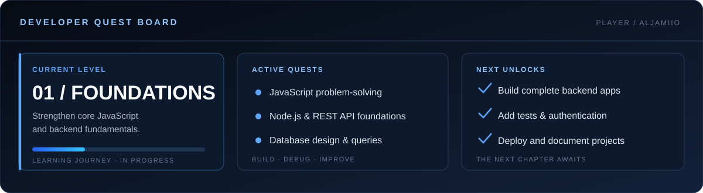

 

 

**Building practical software. Learning deeply. Solving real problems.**

---

## ◈ About Me

Hi, I'm **Md. Jubayer Al Jami**, a final-year Computer Science & Engineering student focused on becoming a capable full-stack software developer.

I enjoy understanding how software works end to end — from a useful user interface to the backend logic and data layer behind it. My current priority is strengthening JavaScript and backend fundamentals, then using that foundation to build complete, reliable web applications.

- 🎓 Final-Year Computer Science & Engineering student
- ⚙️ Currently prioritizing **JavaScript, Node.js and backend engineering**
- 💻 Interested in full-stack development and practical problem-solving
- 🌱 Learning through hands-on practice, projects and iteration
- 🎯 Goal: build software that is useful, maintainable and thoughtfully engineered

## ◈ Tech Stack

**Web Development**

**Programming · Databases**

**Tools · Workflow**

Technologies I have used, studied or am exploring. Proficiency grows through practical work.

## ◈ Developer Quest Board

*Your developer journey, represented as quests. Levels and progress are descriptive milestones, not automatically calculated scores.*

## ◈ Current Mission

<table>
<tr>
<td width="50%" valign="top">

### [01] Backend Engineering
- JavaScript fundamentals
- Node.js & Express
- REST API design
- Authentication & validation
- Database modelling

</td>
<td width="50%" valign="top">

### [02] Developer Craft
- Problem-solving practice
- Clean, readable code
- Debugging & testing
- Git & GitHub workflow
- Deployment & Docker basics

</td>
</tr>
</table>

## ◈ Featured Projects

### [Disaster & Response Timeline](https://github.com/aljamiio/disaster-response-timeline)

Interactive React timeline for visualizing disaster events, volunteer responses and recovery phases.

**React** · **JavaScript** · **Vite** · **CSS**

### [openAbility — Inclusive Learning Platform](https://github.com/aljamiio/openAbility-Learning-Platform)

An HCI-focused inclusive learning platform concept designed to support learners with visual and hearing disabilities in Bangladesh.

**HCI** · **Figma** · **Accessibility** · **UI/UX**

Explore [all repositories](https://github.com/aljamiio?tab=repositories) for coursework, experiments and ongoing work.

## ◈ GitHub Analytics

 

## ◈ Contribution Graph

### Contribution Snake

## ◈ Developer Mindset

> Understand the problem. Break it down. Build with purpose. Improve with every iteration.

  

*Thanks for visiting my profile — more commits, more learning, more building.*

