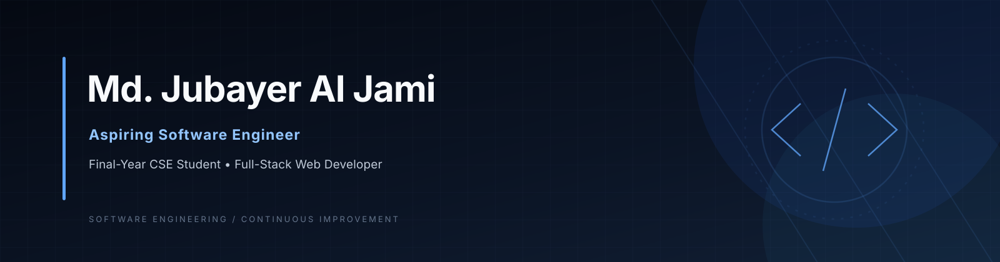

 

  

**ASPIRING SOFTWARE ENGINEER**

*Final-Year CSE Student · Full-Stack Web Developer*

**Building practical software. Learning deeply. Solving real problems.**

---

## About Me

Hi, I'm **Md. Jubayer Al Jami**, a final-year Computer Science & Engineering student with a growing focus on full-stack web development.

I’m interested in understanding how software works end to end — from designing a useful interface to building the backend logic and data layer behind it. My current priority is to strengthen my JavaScript fundamentals and backend engineering skills, then use that foundation to build complete, reliable web applications.

- 🎓 Final-Year Computer Science & Engineering student
- 💻 Focused on full-stack web development
- ⚙️ Currently prioritizing **JavaScript, Node.js and backend fundamentals**
- 🌱 Learning through hands-on practice, projects and problem-solving
- 🎯 Long-term goal: become a developer who can independently design, build, test and maintain real-world software

## Technology Stack

*Technologies I have used, studied, or am currently exploring. My proficiency is developing through practice and projects.*

**Web Development**

**Programming Languages & Databases**

**Tools & Workflow**

## Current Learning Focus

| Area | What I'm working on |
| --- | --- |
| JavaScript | Core concepts, asynchronous programming, problem-solving |
| Backend | Node.js, Express.js, REST APIs, authentication and validation |
| Databases | Data modelling, SQL/NoSQL fundamentals and queries |
| Engineering | Clean code, debugging, testing and Git workflows |
| Next step | Build stronger backend projects, then deepen frontend skills with React and Next.js |

## Selected Projects

### [Disaster & Response Timeline](https://github.com/aljamiio/disaster-response-timeline)
A React-based interactive timeline for visualizing disaster events, volunteer responses and recovery phases.

**Highlights:** Interactive timeline · Filters and sorting · Simulation mode · Responsive interface

**Tech:** React · JavaScript · Vite · CSS

### [openAbility — Inclusive Learning Platform](https://github.com/aljamiio/openAbility-Learning-Platform)
An HCI-focused inclusive learning platform concept designed to support deaf, hard-of-hearing and visually impaired learners in Bangladesh.

**Highlights:** Accessibility-focused concept · Sign-language integration · Audio learning tools · Adaptive interface design

**Tech / Tools:** Figma · UI/UX prototyping · HCI

### More Work
Explore my [repositories](https://github.com/aljamiio?tab=repositories) to see coursework, experiments and ongoing development.

## How I Approach Development

- **Understand first:** clarify the problem before choosing a technology.
- **Build in steps:** break complex tasks into smaller, testable pieces.
- **Keep improving:** learn from debugging, feedback and iteration.
- **Stay practical:** focus on useful functionality rather than unnecessary complexity.

## Connect

  

*Thanks for visiting my profile. I'm always learning, building and improving.*

